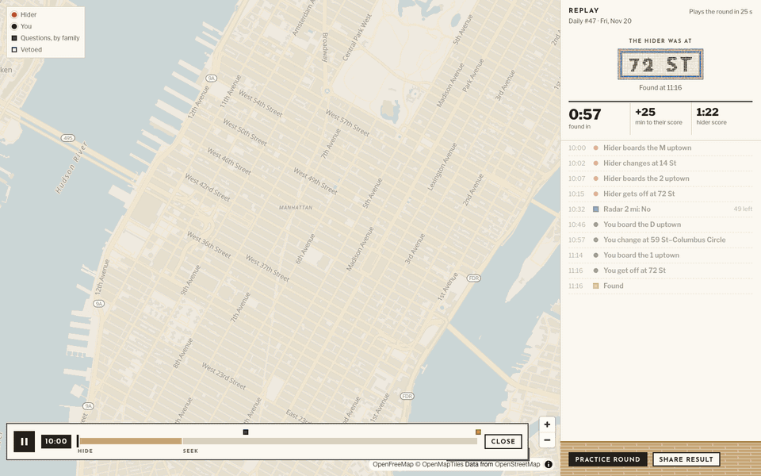
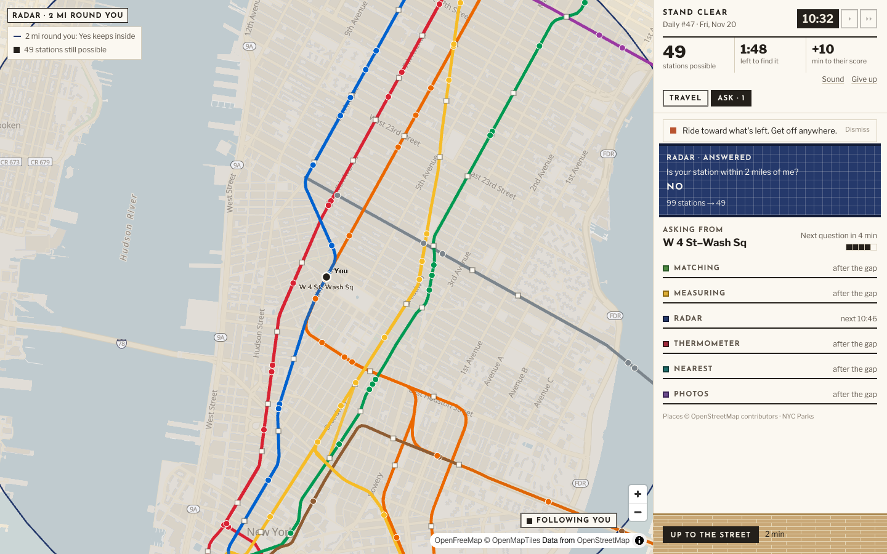
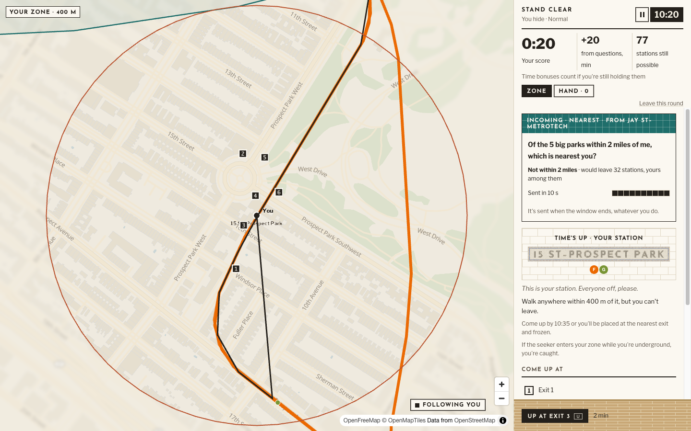

# Stand Clear

Hide and seek on the real New York subway timetable. A hider goes underground at 10:00 and gets off somewhere. You ride the real weekday timetable at 6× speed, ask questions that rule stations out, then come up and find them on the street in Google Street View. Or you hide, and a bot hunts you.



*The replay of a daily: the hider's ride (terracotta), the seeker's (ink), and the questions in between. Local run on the free MapLibre map; production uses Google Maps, which Street View requires.*

**Status:** a solo project, not deployed yet. It runs locally with no accounts and no API keys. The timetable is pinned to Wednesday 2027-03-03.

**How it's built:** [`docs/ARCHITECTURE.md`](docs/ARCHITECTURE.md), a five-minute read. The full design, rules and decision log: [`DESIGN.md`](DESIGN.md).

## Run it

Node 22 or later and pnpm 10.

```sh
pnpm install
pnpm dev:server     # game server on ws://localhost:8787
pnpm dev:web        # client on http://localhost:5173
```

Open http://localhost:5173 and play today's daily or a practice round. With no Google key the client uses MapLibre with OpenFreeMap tiles, so nothing is billed.

| Without keys | Needs Google keys |
|---|---|
| The daily, practice at Easy, Normal and Hard: ride, ask, find the station | The street endgame: Street View, walking, the 40 m sighting and the catch |
| Replays, share text, the daily record, `/hardest`, `/changelog` | Photo questions |
| You hide: the 20-minute hide and the bot's questions, staying below at your station | You hide after 10:20: coming up at an exit and choosing a spot |

Without keys every round ends at the station: reaching the hider's station is the find, and the result says so. The same happens on the free map with keys (`VITE_MAP_PROVIDER=maplibre`), since Google's terms keep Street View off a non-Google map, and when Google refuses the map or a panorama mid-round. Keys and other settings are under [Configuration](#configuration).

## What's in it



- **The daily.** Everyone hunts the same hidden station from the same start. The answer is computed from a server secret, so the page's code can't reveal it.
- **Practice** at three difficulties. The bot hides in a band of stations that take 3–4, 5–6 or 7–8 questions to find.
- **You hide.** Ride for 20 minutes, come up, pick a spot inside 400 m of your station, and answer, veto or randomize the bot seeker's questions while it closes in.



- **Six question families** (Matching, Measuring, Radar, Thermometer, Nearest, Photos) plus on-foot questions in the street search. Each adds minutes to the hider's score, and each answer lands after a one-minute window.
- **A card deck** the hider draws from on every answer: time bonuses, Veto, Randomize, and curses that slow the seeker.
- **Replays** of both routes, and **`/hardest`**, every station ranked by how many questions it takes to find.


## How it is built

- `packages/data`: the MTA's GTFS feed and station tables become one 5 MB JSON file for a pinned weekday (424 station complexes, 8,349 trips, 2,047 street exits).
- `packages/engine`: the rules as pure functions of (state, intent, time). No sockets or timers, so the server, the bots, four balance simulations and the tests run the same code.
- `apps/server`: an authoritative WebSocket server. It holds the whole round, and every message a player gets passes through one visibility filter, so the seeker learns the hider's station only through answers.
- `apps/web`: Vite and React. The client holds the same timetable and a clock sync, and derives every train's position itself; the server sends changes, not ticks.

Strict TypeScript, Biome, Vitest (331 tests). CI runs lint, typecheck, tests, a timetable-freshness check and the web build on every branch push, and the simulations when the engine or the timetable changes. More in [`docs/ARCHITECTURE.md`](docs/ARCHITECTURE.md).

## What was hard

- **Google's terms shaped the architecture.** Street View must sit beside a Google map and can't be relayed through a server, so the whole game moved to Google Maps, and the server stores only panorama IDs, never Google's coordinates. The reasoning is in [`docs/street-view-spike.md`](docs/street-view-spike.md).
- **Balancing a game with no players yet.** Question prices, cooldowns, the deck and the bot's difficulty bands come from bot-vs-bot simulations on the real timetable. The results, and what they changed, are in [`docs/question-balance.md`](docs/question-balance.md), [`docs/endgame-balance.md`](docs/endgame-balance.md) and [`docs/match-balance.md`](docs/match-balance.md).
- **Hidden information.** The seeker must not learn anything the rules don't give them, including from when a message arrives. Several rules in the decision log exist because a review found a leak, and a property test now checks every frame of 39 bot-played rounds.
- **The timetable expires.** The game runs one pinned service day. `pnpm data:check` warns in CI before it lapses; re-pinning is in [`docs/DEPLOY.md`](docs/DEPLOY.md).

## Commands

| Command | What it does |
|---|---|
| `pnpm test` / `pnpm typecheck` / `pnpm lint` | Vitest across all packages / `tsc --noEmit` in each / Biome (`pnpm format` fixes) |
| `pnpm sim` | Questions needed to find the hider's station, and which kinds a strong seeker uses (`docs/question-balance.md`) |
| `pnpm sim:endgame` | How long the street search takes, with and without on-foot questions (`docs/endgame-balance.md`) |
| `pnpm sim:match` | Whole rounds, bot seeker against bot hider, per difficulty: station time, endgame share, score, cards and curse costs (`docs/match-balance.md`) |
| `pnpm sim:hide` | Paced You hide scenarios against the bot seeker, including platform waiting and never locking a spot (`-- --station-only` for rounds without Street View) |
| `pnpm metrics` | Playtest numbers from the server's match logs, in the shape `sim:match` prints |
| `pnpm data:build` | Rebuild the dataset from cached MTA downloads (`--refresh` re-downloads, `--date=YYYY-MM-DD` re-pins) |
| `pnpm data:check` | How far away the pinned service day is |
| `pnpm data:hardness` | Rebuild the `/hardest` table; run after a re-pin |
| `pnpm rename "<New Name>"` | Rename the game in one step: the name constant, package scope, storage keys (with a one-time migration), docs and the link-preview image, then a list of what's left outside the repo. `--dry-run` lists the changes. The daily's seed doesn't change |
| `pnpm --filter @stand-clear/data build-landmarks` | Rebuild the landmarks from OpenStreetMap and NYC Open Data |

The game is at `/play`: `/play?daily`, `/play?practice&difficulty=easy|normal|hard`, `/play?hide&difficulty=…`, `/play?replay` for the last daily's replay in this browser, and `/play?replay=yesterday` for yesterday's daily played by the bot (it works on a phone). A round survives a refresh, a dropped connection and a server restart: the browser keeps a session token and the server holds the round for 3 minutes, with its clock running.

## Configuration

Server (`apps/server/.env.local` locally, gitignored; the host's secrets in production):

| Variable | |
|---|---|
| `DAILY_SECRET` | Mixed into the daily's seed so nobody can compute the answer from the source. Optional locally; **required** when `NODE_ENV=production`, where the server refuses to start without it. |
| `ALLOWED_ORIGINS` | The site's origins, comma-separated. Sockets from any other page are refused. Unset locally, so local and private-network pages may connect (a phone on the same Wi-Fi); **required** in production. |
| `GOOGLE_STREETVIEW_SERVER_KEY` | Street View metadata (free) for hiding spots, exits and walks. Without it, bot rounds end at the station and a You hide hider can't come up. |
| `GOOGLE_MAPS_BROWSER_KEY`, `STREETVIEW_SIGNING_SECRET` | Sign Street View Static photo URLs, so the unsigned quota can be zero. |
| `STREET_ENDGAME=off` | End every round at the station even with keys: the switch for a day Google's quota runs out. |
| `CLIENT_IP_HEADER` | The one forwarding header the proxy in front sets (`x-forwarded-for` behind Caddy, `fly-client-ip` on Fly). Unset, the per-address limits use the socket's address and ignore headers a client could forge. |
| `PORT`, `SESSION_DB`, `MATCH_LOG_DIR` | Listening port (8787), the SQLite file for live sessions, and the match-log directory. |

Client (`apps/web/.env.local`, or the static host's settings):

| Variable | |
|---|---|
| `VITE_GOOGLE_MAPS_API_KEY` | Browser key for the Google map and Street View. Unset, the client uses MapLibre. |
| `VITE_MAP_PROVIDER=maplibre` | Force the free map even with a key, e.g. while working on the UI. Rounds then end at the station. |
| `VITE_SERVER_URL` | The server's `wss://` URL in production. |
| `VITE_SITE_URL` | The site's origin, for the link-preview tags. |

Dev only, per tab: `?map=maplibre` or `?map=google`, and `?server=ws://localhost:8788` to point a tab at another server. Hosting: [`docs/DEPLOY-PLAN.md`](docs/DEPLOY-PLAN.md).

## How this was built

Charlie designed the game, its rules, balance and look, and made the decisions recorded in [`DESIGN.md`](DESIGN.md). Most of the code was written with Claude Code under that direction, and the tests and simulations are the check on it. The commit history keeps the Claude co-author lines. [`docs/UI_BUILD_PROMPT.md`](docs/UI_BUILD_PROMPT.md) and [`docs/S3_BUILD_PROMPT.md`](docs/S3_BUILD_PROMPT.md) are two of the prompts it was given.

## Credits

- **Inspiration.** The format comes from the Hide + Seek seasons of [Jet Lag: The Game](https://en.wikipedia.org/wiki/Jet_Lag:_The_Game), the travel competition series by Wendover Productions. The question families, drawing cards on answers, Veto and Randomize, and curses paid for with cards follow its published home-game rules. The card text, curse names, art and look here are original, and Stand Clear is a fan project, not affiliated with or endorsed by Wendover Productions or Nebula.
- **Timetable and stations:** the MTA's [subway GTFS feed](https://www.mta.info/developers), used under the [MTA data feed terms](https://www.mta.info/developers/terms-and-conditions), and the *MTA Subway Stations* and *MTA Subway Entrances and Exits* datasets on [data.ny.gov](https://data.ny.gov). Stand Clear is not licensed or endorsed by the MTA and uses no MTA logos.
- **Landmarks:** © [OpenStreetMap contributors](https://www.openstreetmap.org/copyright) (ODbL) and NYC Parks open data.
- **Maps:** Google Maps Platform in production; [OpenFreeMap](https://openfreemap.org) tiles, map data © OpenStreetMap contributors, in development.

## License

- **Code:** GNU AGPL-3.0-only, in [`LICENSE`](LICENSE).
- **Writing and art** (this README, `DESIGN.md`, `docs/`, the tile art): CC BY-NC 4.0, in [`LICENSE-docs`](LICENSE-docs).
- **Data:** the OpenStreetMap-derived landmarks are ODbL; the MTA data stays under the MTA's terms. What is under what: [`LICENSES.md`](LICENSES.md).
