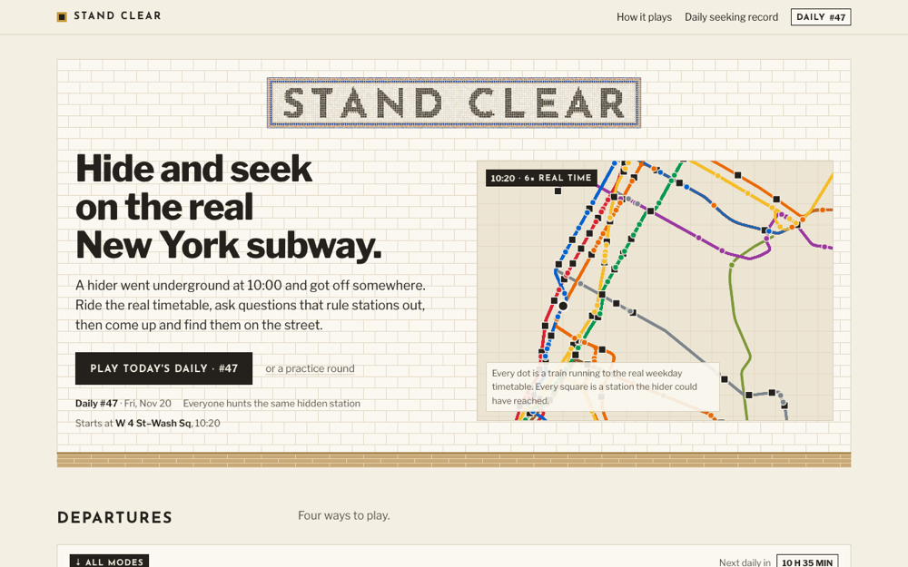
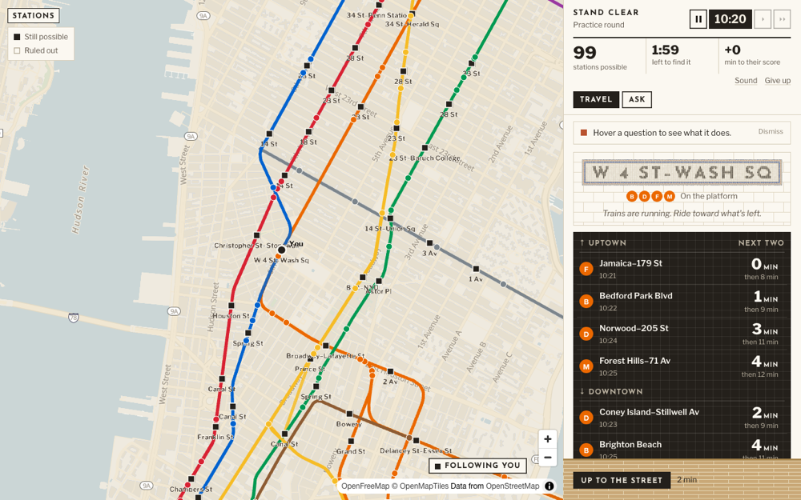
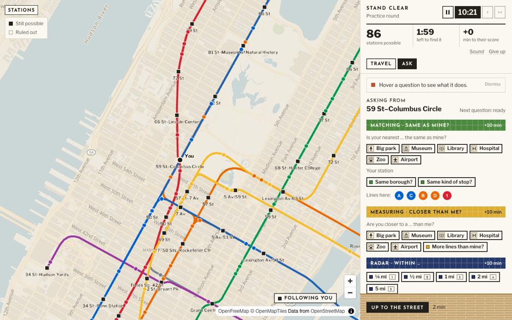

# Stand Clear

Online hide and seek on the real NYC subway timetable and Google Street View. A hider goes underground at 10:00 and gets off somewhere. The seeker rides the real weekday timetable at 6x speed, asks questions that rule stations out, then comes up and finds the hider on the street. Design, rules and build plan: [DESIGN.md](DESIGN.md).







*Screenshots from a local run with `VITE_MAP_PROVIDER=maplibre` (the free OpenFreeMap base map). Production uses Google Maps, which Street View requires.*

## Status

A solo hobby project, not deployed yet. The client builds for Vercel and the server for a single EC2 instance; the plan and what blocked it are in [docs/DEPLOY.md](docs/DEPLOY.md). You can play it locally against a bot today.

## How it is built

- `packages/engine`: the game rules as a pure function, (state, intent, time) to (new state, events). No sockets or timers, so the server, the bot, the balance simulations and the tests run the same code.
- `packages/data`: turns the MTA's open GTFS feed into one 5 MB JSON file for a pinned weekday (424 station complexes, 8,349 trips).
- `apps/server`: authoritative WebSocket server. Every message a player receives passes through one visibility filter, so the seeker never learns the hider's station except through answers.
- `apps/web`: Vite and React client. Clients hold the public timetable and a shared clock and derive train positions, so the server sends events, not ticks.
- Strict TypeScript throughout, Biome for lint and format, Vitest for tests. CI runs lint, typecheck, tests, a timetable-freshness check and the web build.

## What was hard

- **Google's terms shaped the architecture.** Street View must sit beside a Google map and cannot be relayed through a server, so the whole game moved to Google Maps and the server only validates against free metadata. The reasoning is in `docs/street-view-spike.md` and the DESIGN.md decision log.
- **Balancing a game with no players yet.** Question prices, cooldowns and card values were tuned with simulations (`pnpm sim`, `pnpm sim:endgame`, `pnpm sim:match`) and the results are written up in `docs/`.
- **Hidden information.** A seeker must not learn anything the rules do not give them, including from message timing. Several rules in the decision log exist because a review found a leak.
- **The timetable expires.** The game runs one pinned service day, and `pnpm data:check` warns when it gets close. See "Re-pinning the timetable" in `docs/DEPLOY.md`.

## Quickstart

```sh
pnpm install
pnpm dev:server     # game server on ws://localhost:8787
pnpm dev:web        # client on http://localhost:5173
```

The homepage is at `/` and the game at `/play`: `/play?daily` (today's daily, or carry on with it), `/play?practice` (with `&difficulty=easy|normal|hard`), `/play?hide` (Normal seeker, with the same difficulty parameter), and `/play?replay` (the last daily's replay, from this browser). Hide history has separate replay links. Plain `/play` carries on with this browser's round. The server answers `GET /daily` beside its WebSocket with today's start and reachable stations and yesterday's hider; the homepage reads it without starting a round.

Optional env:
- `GOOGLE_STREETVIEW_SERVER_KEY` in `apps/server/.env.local` (gitignored): server key (Street View API only) used to pick bot hiding spots and verify human hiding spots, exits and bot walks. Bot-hide rounds can fall back to "find the station" without it; **You hide requires working Google metadata and browser imagery keys** to leave a station and lock a spot.
- `DAILY_SECRET` (server): mixed into the daily seed so players can't compute the answer. A dev default is used if unset; set a real one anywhere public.
- `VITE_GOOGLE_MAPS_API_KEY` in `apps/web/.env.local` (gitignored): browser key from the `stand-clear-nyc` Google Cloud project, restricted to the Maps JavaScript + Street View Static APIs and `http://localhost:5173/*`. The game's map uses it (Google Maps; one billed map load per page).
- `VITE_MAP_PROVIDER=maplibre` (web): use the free MapLibre/OpenFreeMap base map instead of Google, e.g. while iterating locally. Google's terms require the Google map once Street View is on screen.
- `VITE_SITE_URL` (web): the site's origin for the link-preview tags in `index.html` (`og:url`, `og:image`). Defaults to `http://localhost:5173`; set on Vercel (`docs/DEPLOY.md`).
- Dev only, per tab: `?map=maplibre` (or `google`) picks the base map, and `?server=ws://localhost:8788` points the tab at another server, for headless checks without billed map loads.

You hide offers Pause throughout and hiding-phase fast-forward capped at 10:20; seeking has no skip. Its result is seeker time plus question bonuses and time-bonus cards still held. The homepage's **Daily seeking record** counts daily seeking only; **Hide history** is separate. Leaving early keeps an incomplete replay with no score or share result.

A round survives a refresh or a dropped connection: the browser keeps a session token and the server holds the round for 3 minutes. Its clock keeps running meanwhile (solo rounds don't pause on a drop). With `GOOGLE_STREETVIEW_SERVER_KEY` set, the server also checks street-walk targets against Street View metadata; human-hide verification retries a lookup error once.

Human-hide server snapshots store panorama IDs and rehydrate coordinates when restored. Browser hide replays keep the latest twenty rounds with street positions reduced to public MTA exits; completed score history remains. No Google coordinates are saved in those snapshots or replays.

## Commands

| Command | What it does |
|---|---|
| `pnpm data:hardness` | Rebuild `apps/web/src/home/hardness.json`, the /hardest page's ranking of every station by questions-to-find per hub; run after a re-pin |
| `pnpm data:build` | Rebuild `packages/data/dataset/nyc-subway.json` from cached MTA downloads (`--refresh` re-downloads) |
| `pnpm --filter @stand-clear/data build-landmarks` | Rebuild `nyc-landmarks.json` (parks, museums, libraries, hospitals, zoos, airports) from OpenStreetMap + NYC Open Data |
| `pnpm test` | Vitest across all packages |
| `pnpm sim` | Balance check: questions to find the hider's station, and which kinds a strong seeker uses (`--pace 8`, `SIM_RULES=…`; see `docs/question-balance.md`) |
| `pnpm sim:endgame` | Balance check: how long the street search takes, with and without on-foot questions (see `docs/endgame-balance.md`) |
| `pnpm metrics` | Playtest metrics from the match logs, in the shape `sim:match` prints so human rounds read against the bot's: found and give-up rates, station and endgame time, questions by category, cards, real seconds between decisions (`--dir=`, `--since=`, `--mode=`) |
| `pnpm sim:match` | Balance check: a bot seeker plays whole rounds against the bot hider with real travel time — station time, endgame share, hider score, cards and curse costs per difficulty (`--rounds`, `--hub`, `--difficulty`, `--seed`, `SIM_RULES`, `SIM_DECK`, `SIM_COST`; see `docs/match-balance.md`) |
| `pnpm sim:hide` | Paced human-hide scenarios: ten per seeker level, identical seeds, platform waiting and never-lock cases; virtual clock and synthetic panoramas (`--rounds`, `--difficulty`, `--seed`, `--endgame-at`, `--json`; see `docs/match-balance.md`) |
| `pnpm typecheck` | `tsc --noEmit` in every package |
| `pnpm lint` / `pnpm format` | Biome check / fix |

## Layout

- `packages/data`: MTA open data → the game's dataset (one pinned weekday), plus landmarks for questions
- `packages/engine`: pure game rules (no I/O)
- `apps/server`: authoritative WebSocket game server
- `apps/web`: Vite + React client

## Data attribution

Timetable and station data from the [MTA](https://new.mta.info/developers) (subway GTFS) and [data.ny.gov](https://data.ny.gov) (MTA Subway Stations; MTA Subway Entrances and Exits). Map data © OpenStreetMap contributors.
